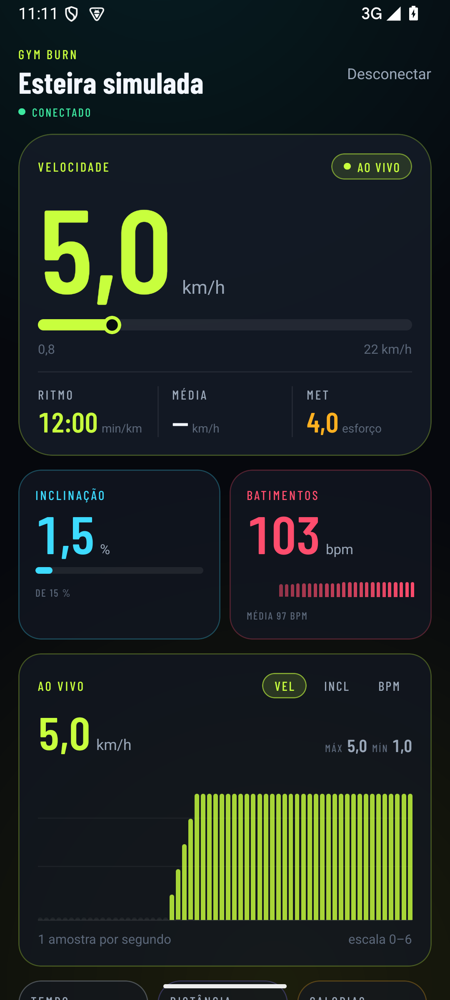
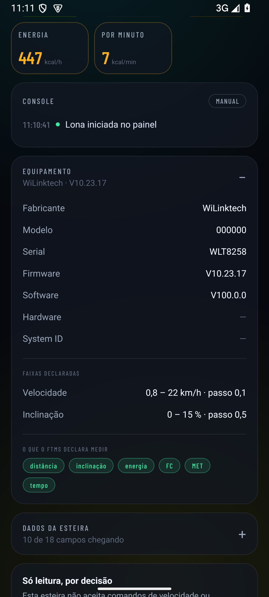
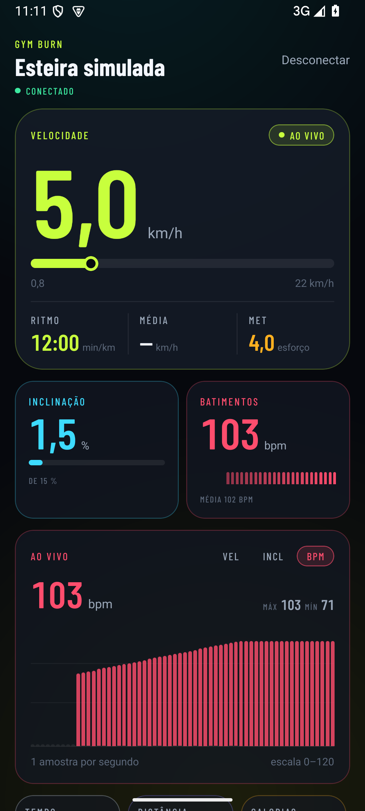

# Gym Burn

Monitor de esteira para Android: um app Expo/React Native que lê em tempo real os dados de uma
Matrix T600X por Bluetooth Low Energy direto, em modo **100% somente leitura** e com interface em
português do Brasil.

O app não liga, não para e não ajusta a lona. Ele encontra a esteira sozinho, conecta por BLE usando
o perfil FTMS (Fitness Machine Service, `0x1826`) e transforma as notificações do equipamento num
painel de treino. Quem controla a esteira continua sendo o painel dela.

## Telas

<p align="center">
  
  
  
</p>
<p align="center">
  
  
  
</p>

Capturas do modo demonstração (esteira simulada), no Android 15. A identidade do equipamento
mostrada é a da T600X real: o app lê o módulo BLE que ela expõe.

## O que o app faz

- **procura esteiras sozinho** ao abrir a tela de conexão, sem pedir que você pareie pelo sistema;
- **conecta por BLE direto** (GATT) na esteira que você confirmar, com o perfil FTMS;
- **assina a telemetria** de Treadmill Data (`0x2ACD`), Machine Status (`0x2ADA`) e Training Status
  (`0x2AD3`), e lê a identidade e as capacidades do equipamento ao conectar;
- **atualiza o cockpit cerca de uma vez por segundo**, com velocidade, inclinação, batimentos,
  tempo, distância, calorias e MET;
- **guarda os últimos 60 segundos** de velocidade, inclinação e frequência cardíaca para o gráfico
  ao vivo;
- **traduz os eventos do console** (início, parada, pausa, mudança de alvo feita no painel, chave de
  segurança) em avisos legíveis;
- **mostra com honestidade o que a esteira não manda**, marcando `—` nos campos que o firmware
  declara mas nunca envia;
- tem um **modo demonstração** escondido para experimentar o app sem esteira por perto.

Em resumo: ele informa; ele não comanda.

## O que ele mostra

| Dado | Unidade | Origem |
| --- | --- | --- |
| Velocidade instantânea | km/h | Treadmill Data (0x2ACD) |
| Inclinação | % | Treadmill Data (0x2ACD), corrigida para a escala do firmware |
| Frequência cardíaca | bpm | Treadmill Data (0x2ACD); 0 vira `—` (sem contato) |
| Tempo decorrido | mm:ss / h:mm:ss | Treadmill Data (0x2ACD) |
| Distância total | km | Treadmill Data (0x2ACD), em metros |
| Ritmo | min/km | calculado pelo app a partir da velocidade |
| Velocidade média | km/h | Treadmill Data (0x2ACD) — a T600X não envia; aparece `—` |
| Energia total | kcal | Treadmill Data (0x2ACD) |
| Gasto por hora | kcal/h | Treadmill Data (0x2ACD) |
| Gasto por minuto | kcal/min | Treadmill Data (0x2ACD) |
| MET | METs | Treadmill Data (0x2ACD) |
| Eventos do console | — | Fitness Machine Status (0x2ADA) |
| Estado de treino declarado | — | Training Status (0x2AD3), informativo |
| Identidade do equipamento | — | Device Information (0x180A): fabricante, modelo, serial, firmware, software, hardware e System ID |
| O que a esteira declara medir | — | Fitness Machine Feature (0x2ACC) |
| Faixas de velocidade e inclinação | km/h, % | Supported Speed Range (0x2AD4) e Supported Inclination Range (0x2AD5) |

O cockpit tem velocidade em destaque, inclinação e batimentos ao lado, o gráfico dos últimos 60 s, a
grade de métricas, um cartão com o equipamento encontrado e uma lista dos campos que o modelo não
envia. A referência completa dos campos e das escalas está em
[docs/dados-da-esteira.md](docs/dados-da-esteira.md).

## Treinos guiados

Na primeira abertura, informe idade, peso, altura e nível de atividade em **Meu perfil**. Para habilitar a IA, salve sua chave pessoal da DeepSeek nesse mesmo local. A chave fica no armazenamento seguro do sistema. O perfil e os registros de treino ficam no banco SQLite do aparelho.

Toque em **Treino do dia** antes ou depois de conectar a esteira. O plano gerado fica salvo no celular para aquele dia. A escolha automática usa seu perfil, as faixas de BPM e as sessões válidas recentes (3 minutos ou mais em movimento). Também é possível selecionar o objetivo e ajustar os 45 minutos iniciais. Revise as etapas e toque em **Iniciar treino guiado**. Os avisos de ajuste e medição abrem na parte inferior da tela e tocam três bipes. A esteira confirma os alvos pela telemetria. Para o sensor, o app aguarda 6 leituras novas de BPM, cerca de 10 segundos. É possível minimizar e reabrir o aviso pelo painel.

Ajuste a velocidade e a inclinação pelo painel. O tempo do guia acompanha o movimento medido da lona.

O registro livre começa quando a lona anda. A conclusão do guia, uma parada informada pelo console, a desconexão ou **Encerrar registro** encerram a sessão. Em **Evolução**, consulte as avaliações por data ou tente novamente se a internet falhar. As demonstrações têm histórico próprio.

Para começar do zero, **Meu perfil → Apagar perfil e treinos** remove perfil, histórico, plano do dia e diário da IA. A chave da DeepSeek continua salva.

### Frequência cardíaca

A esteira só lê batimentos com a lona andando. Por isso o guia pede a primeira leitura logo no início, ainda na velocidade mínima: é a FC de repouso do dia. Essa leitura fica acima do repouso real, porque a pessoa já está em pé e andando. O app usa a menor das 5 últimas e desconta 15 bpm.

A FC máxima começa em 220 − idade. Depois de cada sessão avaliada, a IA devolve uma previsão, e o app passa a usar a mediana das 3 últimas. A previsão fica presa a 10 bpm das estimativas pela idade e nunca abaixo do maior pico já observado. Caminhada submáxima não mede a FC máxima, então o erro típico continua na casa de ±10 bpm.

Com repouso medido, a faixa de BPM do treino sai da reserva de frequência cardíaca; sem ele, de percentuais da máxima. A faixa pela reserva nunca se afasta mais de 10 bpm da faixa pela máxima, para uma leitura ruim de repouso não deslocar o alvo. É uma orientação de treino, não uma medição clínica. [Referência da American Heart Association](https://www.heart.org/en/healthy-living/exercise-and-physical-activity/fitness-basics/target-heart-rates).

### Quando a IA é chamada

As três chamadas usam o modelo `deepseek-flash` da DeepSeek, sempre com raciocínio ligado. A API ignora `temperature` nesse modo, por isso o app não envia esse parâmetro.

| Chamada | Quando | Esforço de raciocínio | O que a DeepSeek recebe |
| --- | --- | --- | --- |
| Plano do dia | toque em **Gerar treino com IA** | `high` | perfil, FC de repouso e máxima, faixas de BPM, duração, modo e resumo das sessões válidas recentes |
| Revisão de carga | durante o guia, quando as leituras saem da faixa e há mais de uma decisão possível | `low` | idade, nível de atividade, faixa do dia, etapa atual, resumo e leituras recentes de BPM, ajustes já feitos |
| Avaliação | ao fim de uma sessão com 3 minutos e 10 leituras ou mais | `max` | idade, nível de atividade, resumo da sessão por tipo de bloco e das sessões anteriores, estimativas de FC máxima |

O plano tem teto de progressão: não passa de 0,5 km/h e 1% acima da maior carga principal recente, ou do teto do nível de atividade quando ainda não há histórico.

A revisão usa a mediana de pelo menos 4 leituras, depois de descartar as 2 primeiras de cada pegada no sensor. Com o BPM na faixa nada é enviado. A carga só sobe em bloco de esforço, com os alvos atingidos há 2 minutos. Depois de um ajuste, o guia espera 1 minuto antes de revisar de novo. Uma resposta que chega atrasada só é aplicada se a etapa e a carga forem as mesmas e se as leituras dos últimos 30 segundos ainda admitirem a mesma decisão. O ajuste de um bloco de esforço vale também para os blocos iguais que ainda virão. Com internet indisponível o guia segue o plano local.

Cada chamada tem até 3 novas tentativas em falha de rede, erro do servidor ou resposta fora do formato.

### Diagnóstico da IA

Em **Meu perfil → Diagnóstico da IA** ficam o diário das 200 últimas chamadas (o que foi enviado, o que voltou e quanto demorou), que pode ser compartilhado, e um conjunto de cenários fixos que mede o acerto da IA com a sua chave. Uma rodada completa leva vários minutos e custa centavos de dólar. Pelo adb:

```bash
adb shell am start -a android.intent.action.VIEW -d 'gymburn://diagnostico?rodar=1' com.gymburn.app
adb logcat -s ReactNativeJS | grep gymburn-diag
```

## Como usar na academia

1. **Coloque o painel da esteira no modo APP.** Na Matrix T600X, segure a tecla Bluetooth do painel
   por cerca de 5 segundos, até ele entrar nesse modo. Sem isso a esteira não se anuncia para o
   celular.
2. **Abra o Gym Burn.** Ele começa a procurar sozinho e pede a permissão de Bluetooth ("Dispositivos
   por perto" no Android 12 ou mais novo; Localização no Android 11 ou anterior, por exigência do
   sistema).
3. **Toque no nome da sua esteira.** Numa academia com várias iguais, esse toque é a confirmação de
   qual é a sua — o sinal sozinho não garante.
4. **Use o painel para tudo.** Ajuste velocidade e inclinação por ele, e apoie o celular num lugar
   seguro. O app só acompanha.

Não é preciso parear pela tela de Bluetooth do sistema: a esteira é um periférico BLE e o app
conecta direto. A tela de conexão também traz um cartão com esses três passos.

O app mantém a tela acesa enquanto acompanha o treino, para o celular não apagar no meio da série.

### Modo demonstração

Sem esteira por perto, dá para ver o cockpit funcionando: na tela de conexão, faça um **toque longo
na marca GYM BURN**. O app conecta numa esteira simulada, que fala FTMS em bytes como a de verdade,
e o restante da interface se comporta igual.

## Por que o app não controla a esteira

- O FTMS tem um campo chamado **Target Setting Features** (`0x2ACC`) em que o equipamento declara o
  que **aceita como alvo de controle**. Na T600X esse campo vale `0x10`, isto é, apenas frequência
  cardíaca: a esteira declara explicitamente que **não aceita alvo de velocidade nem de
  inclinação** por esse perfil. Mandar comandos seria contrariar o que o próprio equipamento
  informa.
- **Quem controla a máquina é o painel.** Velocidade, inclinação, iniciar, pausar e parar são feitos
  pelos botões do console, e a parada real é o **Emergency Stop** (o botão vermelho) e a **chave de
  segurança** presa nele.
- **Segurança.** Um app que só lê não tem como ligar a lona, mudar a velocidade ou disparar um
  comando por engano; se a conexão cair, a esteira continua exatamente como estava. O app também não
  substitui nenhuma proteção do painel.
- Por isso o app **não escreve** em características de controle: ele apenas habilita notificações
  das características de dados. O que a tela mostra a respeito de eventos do console é o que o
  painel fez, não o que o app mandou.

## Instalação e uso

Requisitos:

- Node.js compatível com o Expo SDK 58 (as versões aceitas estão em `engines` do pacote `expo`:
  `^22.13.0`, `^24.3.0`, `^26.0.0` ou `>=27`);
- JDK 17 ou 21;
- Android SDK instalado, com `ANDROID_HOME` definido;
- um celular Android de verdade com depuração USB. **O emulador não alcança o rádio Bluetooth** —
  ele serve só para o modo demonstração;
- iOS exige macOS e Xcode e não foi compilado nem testado.

O Expo Go não serve: a biblioteca de Bluetooth (`react-native-ble-manager`) tem código nativo, então
é preciso um build próprio.

```bash
npm install
npm run android
```

`npm run android` é `expo run:android`: gera a pasta `android/` por prebuild, compila, instala no
celular conectado e abre o Metro.

Para usar na academia sem o computador, faça um build que embute o JavaScript:

```bash
npx expo run:android --variant release
```

Depois de mudar `app.json` (plugins, permissões, pacote `com.gymburn.app`), regenere a pasta nativa:

```bash
npx expo prebuild --clean -p android
```

As pastas `android/` e `ios/` são geradas e estão no `.gitignore`; não edite à mão.

## Arquitetura

A interface só lê um snapshot imutável da sessão e chama ações. A sessão cuida de busca, conexão,
descoberta do GATT e leitura das notificações, e depende apenas do contrato `BleTransport` — por
isso o rádio real e a esteira simulada são intercambiáveis. O codec FTMS é código puro, sem React e
sem Bluetooth.

```
telas e componentes (src/screens, src/components)
        │  snapshot imutável / ações
        ▼
sessão (src/treadmill/treadmill-session.ts)
        │  contrato BleTransport (src/ble/transport.ts)
        ▼
rádio react-native-ble-manager  │  esteira simulada (src/simulator)
        │
        ▼
esteira Matrix T600X  ── codec FTMS puro em src/ftms
```

| Pasta | Papel |
| --- | --- |
| `src/app` | rotas do Expo Router; a rota principal mostra a conexão ou o cockpit conforme a fase da sessão |
| `src/screens` | tela de conexão e tela do cockpit |
| `src/components` | primitivas visuais e blocos do cockpit (gráfico, cartões, métricas, avisos) |
| `src/treadmill` | sessão (estado, busca, conexão, leitura), contrato de tipos, contexto React e constantes da T600X |
| `src/ftms` | codec puro do FTMS: bytes, Treadmill Data, Machine Status, Training Status, Device Information, Feature e faixas |
| `src/ble` | contrato `BleTransport`, implementação com `react-native-ble-manager` e permissões do Android |
| `src/simulator` | esteira simulada que fala FTMS em bytes; usada no modo demonstração e nos testes |
| `src/workouts` | treinos guiados: plano e etapas, sessão de treino, regras de carga, frequência cardíaca, prompts e chamadas à DeepSeek, cenários de diagnóstico e banco SQLite |
| `src/hooks` | tema e relógio de interface |
| `src/utils` | formatação de números e textos em português do Brasil |
| `src/constants` | tokens de tema: cores, tipografia, espaçamento |

`src/app-services.ts` cria a sessão e o transporte, que vivem durante toda a execução do app.

## Testes

```bash
npm test
npm run typecheck
npm run lint
```

A suíte cobre o codec do FTMS (bytes, Treadmill Data, Device Information, Feature e faixas), as
permissões de Bluetooth do Android, a esteira simulada e a sessão de ponta a ponta com um transporte
falso. Nenhum teste toca o rádio de verdade: a esteira simulada fala os mesmos bytes do FTMS, e o
modo demonstração exercita exatamente o mesmo caminho da esteira real.

Nos treinos guiados, a suíte cobre o plano, a sessão, as regras de carga, a frequência cardíaca e a
montagem e validação dos prompts, sem chamar a DeepSeek. A qualidade das respostas da IA é medida à
parte, no aparelho, pelos cenários de **Diagnóstico da IA**.

## Limitações conhecidas do firmware

- **Escala da inclinação.** O firmware usa o campo de 0,1 % da especificação para um contador
  interno cuja escala real é `raw × 0,015` — 6,667× maior que a leitura da especificação. O app
  corrige o valor para exibir o mesmo percentual do painel.
- **Frequência cardíaca 0 = sem contato.** O firmware manda 0 quando ninguém está segurando as
  alças com sensor; o app mostra `—` em vez de 0 bpm.
- **Campos declarados que nunca chegam.** A esteira anuncia recursos que não implementa: velocidade
  média, ritmo, tempo restante, ganho de elevação, força e potência. O app exibe `—` nesses lugares
  e avisa na seção de detalhes que o modelo não envia esses campos. O ângulo de rampa chega fixo em
  0,5° e não acompanha a inclinação.
- **Training Status "pegajoso".** O estado de treino pode continuar dizendo "pós-treino" com a
  pessoa andando. O app não usa esse campo para saber se a lona anda — a velocidade medida no
  Treadmill Data é a fonte de verdade.
- **Faixa de inclinação declarada é template.** A faixa de 0–50 % com passo de 3 % anunciada pelo
  FTMS é constante de firmware, não a faixa mecânica da máquina; o app não a usa como faixa real.
- **Identidade do módulo.** O Device Information identifica o módulo de comunicação BLE, não o
  console, e o Model Number vem `000000` (valor de preenchimento). O nome anunciado da esteira é a
  melhor pista de qual equipamento é.

## Licença

MIT. Veja [`LICENSE`](LICENSE).
