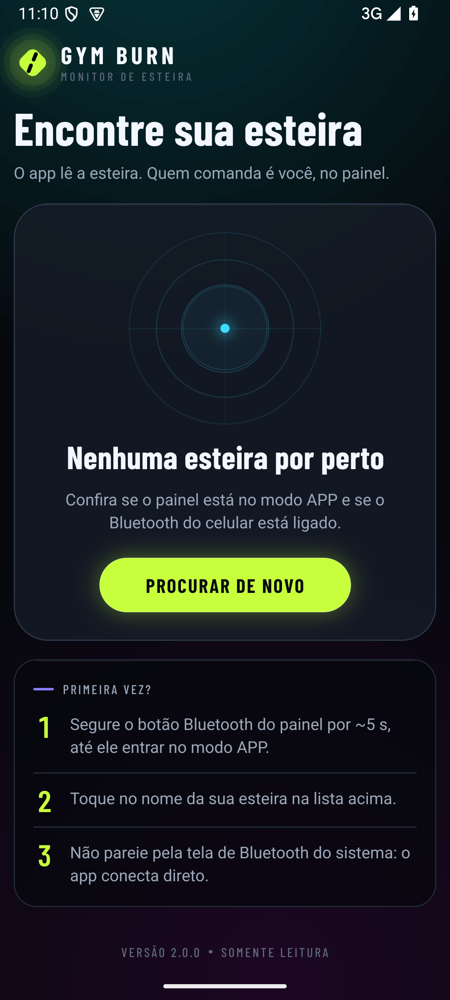
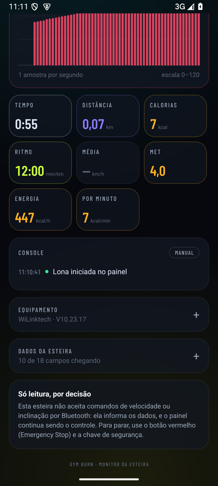
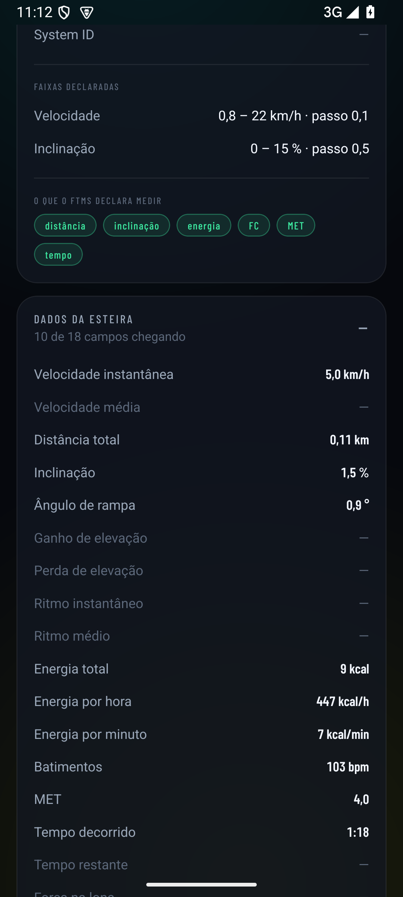

# Gym Burn

Monitor de esteira para Android: um app Expo/React Native que lê em tempo real os dados de uma
Matrix T600X por Bluetooth Low Energy direto, em modo **100% somente leitura** e com interface em
português do Brasil.

O app não liga, não para e não ajusta a lona. Ele encontra a esteira sozinho, conecta por BLE usando
o perfil FTMS (Fitness Machine Service, `0x1826`) e transforma as notificações do equipamento num
painel de treino. Quem controla a esteira continua sendo o painel dela.

A única escrita do app em Bluetooth é na cinta de batimentos XOSS X2 Pro, pelo canal proprietário
dela (passos, gravação do treino na memória da cinta, alerta de FC e perfil; veja
[Cinta XOSS X2 Pro](#cinta-xoss-x2-pro)). A esteira continua 100% só leitura.

## Telas

<p align="center">
  
  
  
</p>
<p align="center">
  
  
</p>

Capturas do modo demonstração (esteira simulada), no Android 15. A identidade do equipamento
mostrada é a da T600X real: o app lê o módulo BLE que ela expõe.

## O que o app faz

- **procura esteiras sozinho** ao abrir a tela de conexão, sem pedir que você pareie pelo sistema;
- **conecta por BLE direto** (GATT) na esteira que você confirmar, com o perfil FTMS;
- **assina a telemetria** de Treadmill Data (`0x2ACD`), Machine Status (`0x2ADA`) e Training Status
  (`0x2AD3`), e lê a identidade e as capacidades do equipamento ao conectar;
- **atualiza o cockpit cerca de uma vez por segundo**, com velocidade, inclinação, batimentos,
  tempo, distância e calorias;
- **guarda as 300 leituras mais recentes** de velocidade, inclinação e frequência cardíaca (de 2 a
  5 minutos), de onde saem o ajuste da carga e o cartão da zona de batimentos;
- **traduz os eventos do console** (início, parada, pausa, mudança de alvo feita no painel, chave de
  segurança) em avisos legíveis;
- **lê os batimentos de uma cinta no peito**, quando há uma pareada, com os intervalos entre
  batimentos (RR), e fica com o sensor de mão da esteira como reserva;
- com a cinta, **mede o repouso e a prontidão do dia** (HRV) com a pessoa parada na esteira, antes
  de ligar a lona;
- na **XOSS X2 Pro**, lê também a cadência, grava o treino guiado na memória da cinta e acerta nela
  o alerta de FC e o perfil;
- **guarda o treino segundo a segundo** (BPM, cadência, velocidade, inclinação e RR), numa tabela à
  parte do registro do treino;
- **mostra com honestidade o que a esteira não manda**, marcando `—` nos campos que o firmware
  declara mas nunca envia;
- tem um **modo demonstração** escondido para experimentar o app sem esteira por perto.

Em resumo: ele informa; ele não comanda.

## O que ele mostra

| Dado | Unidade | Origem |
| --- | --- | --- |
| Velocidade instantânea | km/h | Treadmill Data (0x2ACD) |
| Inclinação | % | Treadmill Data (0x2ACD), corrigida para a escala do firmware |
| Frequência cardíaca | bpm | Treadmill Data (0x2ACD); 0 vira `—` (sem contato) |
| Tempo decorrido | mm:ss / h:mm:ss | Treadmill Data (0x2ACD) |
| Distância total | km | Treadmill Data (0x2ACD), em metros |
| Velocidade média | km/h | Treadmill Data (0x2ACD) — a T600X não envia; aparece `—` |
| Energia total | kcal | Treadmill Data (0x2ACD) |
| Gasto por hora | kcal/h | Treadmill Data (0x2ACD) |
| Gasto por minuto | kcal/min | Treadmill Data (0x2ACD) |
| MET | METs | Treadmill Data (0x2ACD) |
| Eventos do console | — | Fitness Machine Status (0x2ADA) |
| Estado de treino declarado | — | Training Status (0x2AD3), informativo |
| Identidade do equipamento | — | Device Information (0x180A): fabricante, modelo, serial, firmware, software, hardware e System ID |
| O que a esteira declara medir | — | Fitness Machine Feature (0x2ACC) |
| Faixas de velocidade e inclinação | km/h, % | Supported Speed Range (0x2AD4) e Supported Inclination Range (0x2AD5) |

O cockpit mostra a etapa do guia (tempo que falta nela, andamento do treino e a etapa seguinte), o
medidor das zonas de frequência cardíaca, a carga lida da esteira (velocidade e inclinação, com o
alvo da etapa ao lado do rótulo), os batimentos minuto a minuto e os totais de tempo, distância e
calorias. O medidor é um arco com as cinco zonas (Z1 a Z5, de 10 em 10 pontos percentuais a partir
de 50% da FC máxima): a faixa do dia fica acesa, a mira dentro dela aparece num vermelho mais vivo
e uma seta do lado de fora aponta a última leitura, que vai no centro com o que ela diz do alvo. O
gráfico por minuto tem uma coluna por minuto, na cor da zona, preenchida à medida que as leituras
de BPM chegam, com a faixa do dia ao fundo e, no eixo, o que o guia fez com a carga. O painel
ocupa a tela inteira, e só o gráfico por minuto estica para preenchê-la.

Com a cadência da XOSS X2 Pro, o bloco de velocidade ganha um rodapé com a cadência e a passada
(**168 passos/min · 0,94 m**); os dois blocos de carga apertam o respiro de cima e de baixo para a
linha caber sem o painel crescer. No cartão da etapa, a linha de baixo troca o "A seguir" pelo que
importa mais naquele momento, nesta ordem: **Fora da lona · a carga não sobe**, a dica **Cadência
caindo: passos mais curtos e rápidos** (num lugar só dela, que o texto do guia, no eixo do gráfico,
não sobrescreve), numa recuperação entre tiros a carga já decidida para o próximo (**Próximo tiro ·
6,2 km/h e 1% · carga reduzida**, ou **mesma carga**) e, nos primeiros 30 segundos de um tiro, como o
coração encerrou a recuperação antes dele (**Recuperação encerrada mais cedo, aos 2:15**). Numa
recuperação entre tiros, o rótulo de cima diz o estado dela: **guiada pelo coração**, **alongada até
4:10** ou **no tempo do plano**.

Um toque longo no nome da esteira abre o cartão do equipamento e a lista dos campos que o
modelo não envia. A referência completa dos campos e das escalas está em
[docs/dados-da-esteira.md](docs/dados-da-esteira.md).

## Treinos guiados

Na primeira abertura, informe idade, peso e altura em **Meu perfil**. Para habilitar a IA, salve sua chave pessoal da DeepSeek nesse mesmo local. A chave fica no armazenamento seguro do sistema. O perfil e os registros de treino ficam no banco SQLite do aparelho. O texto de privacidade dessa tela diz o que sai do celular: para a IA, a idade e o resumo dos treinos e, durante o treino guiado, BPM, velocidade, inclinação e cadência recentes; para a cinta, quando ela é uma XOSS X2 Pro, peso, altura, idade e FC máxima. O cartão **Frequência cardíaca** diz se o repouso em uso foi medido parado ou andando.

Toque em **Treino do dia** antes ou depois de conectar a esteira. A tela abre na sessão de hoje do plano semanal (veja abaixo) e deixa escolher a de outro dia. Logo abaixo do cartão principal fica o cartão **Repouso e prontidão**: o repouso de hoje e como foi medido (o medido parado, se houver; senão, o do 1º minuto andando), o estado da prontidão do dia (veja [Prontidão do dia](#prontidão-do-dia)) e, com a cinta lendo, a esteira conectada e a lona parada, o andamento da medida em curso (**Medindo parado · 34 de 60 s**). Com a bateria da cinta abaixo de 15%, a tela avisa no alto. A IA define a velocidade e a inclinação de partida dos blocos de esforço a partir das sessões válidas recentes (3 minutos ou mais em movimento), e o plano gerado fica salvo no celular para aquele dia. Revise as etapas e toque em **Iniciar treino guiado**. Os avisos de ajuste e medição abrem na parte inferior da tela e tocam três bipes. A esteira confirma os alvos pela telemetria. Para o sensor, o app aguarda 6 leituras novas de BPM, cerca de 10 segundos. Um toque fora do aviso o recolhe, e **Ver aviso**, no painel, o reabre.

Ajuste a velocidade e a inclinação pelo painel. O tempo do guia acompanha o movimento medido da lona.

O registro livre começa quando a lona anda. A conclusão do guia, uma parada informada pelo console ou a desconexão encerram a sessão. Ao encerrar, o painel mostra as kcal estimadas da sessão (veja abaixo). Em **Evolução**, consulte as avaliações e as kcal por data, ou tente a avaliação de novo se a internet falhar. Cada treino traz ali também como o repouso foi medido (**repouso 62** parado, **1º minuto 86** andando), a cadência média quando houve (sem os segundos fora da lona) e, se a trilha foi completada pelo FIT da cinta, quantos segundos vieram dele (**340 s recuperados da cinta**). Cada registro pode ser apagado ali, em **Apagar registro**. As sessões da esteira simulada não ficam guardadas: o app as descarta quando é aberto de novo.

Para começar do zero, **Meu perfil → Apagar perfil e treinos** remove perfil, histórico, medidas de prontidão, plano do dia e diário da IA. A chave da DeepSeek e a cinta pareada continuam salvas.

### Plano semanal

O guia segue uma semana fixa: um treino de 45 minutos por dia, de segunda a sábado, com a faixa de frequência cardíaca dos blocos de esforço em percentual da FC máxima:

| Dia | Sessão | Estrutura | Faixa |
| --- | --- | --- | --- |
| Segunda e quinta | Base aeróbica | contínuo | 65–75% |
| Terça | VO₂máx | 10 min aquecendo, 4 × 4 min com 3 min leves, 7 min desaquecendo | 90–95% nos tiros |
| Quarta | Recuperação ativa ou caminhada inclinada | contínuo, bem leve | abaixo de 60–65% |
| Sexta | Limiar | 10 min aquecendo, 3 × 8 min com 2 min leves, 5 min desaquecendo | 85–90% nos blocos |
| Sábado | Base aeróbica ou caminhada inclinada | contínuo | 65–75% |
| Domingo | descanso | | |

Nos dias contínuos os 45 minutos incluem 5 de entrada e 5 de saída em ritmo leve. Na quarta, "abaixo de 60–65%" é um teto: o app busca 50–60% e alivia a carga assim que a FC passa disso. Onde o plano escreve "ou caminhada inclinada" (quarta e sábado) o treino é um só: a rampa entra pela escada de cargas descrita abaixo, quando a faixa pede mais do que a caminhada plana oferece. A semana está em `src/workouts/week.ts`.

Os alvos dos treinos ficam dentro das cinco zonas de frequência cardíaca que o painel desenha:

| Zona | % da FC máxima | Sensação | Para quê |
| --- | --- | --- | --- |
| Z1 – Recuperação | 50–60% | muito leve, dá para conversar fácil | aquecimento, recuperação ativa |
| Z2 – Aeróbica base | 60–70% | leve, conversa tranquila | queima de gordura, base de resistência |
| Z3 – Aeróbica moderada | 70–80% | moderado, frases curtas | condicionamento aeróbico, eficiência cardíaca |
| Z4 – Limiar | 80–90% | forte, só palavras soltas | aumentar o limiar de lactato, ritmo de prova |
| Z5 – Máximo (VO₂máx) | 90–100% | máximo, insustentável por muito tempo | tiros curtos, potência e velocidade |

A recuperação de quarta é a Z1, a base aeróbica (65–75%) pega o alto da Z2 e o começo da Z3, o limiar (85–90%) fica na Z4 e os tiros de VO₂máx (90–95%) na Z5.

A estrutura e a faixa não mudam; a IA escolhe só a carga de partida. Não há teto de velocidade ou inclinação além do que a esteira alcança (22 km/h e 15%), nem limite de aumento de uma sessão para a outra: a carga já busca a faixa no primeiro treino de cada tipo. Para isso o app calcula o custo metabólico de cada carga em METs (equações do ACSM, de caminhada abaixo de 6 km/h e de corrida a partir daí) e monta uma escada de cargas: caminhada plana até 5,2 km/h, depois rampa a 5,2 km/h até 7,5%, depois corrida a 1%, de 6 km/h em diante. Quem ainda chega à faixa andando não recebe corrida. A caminhada vai até 5,2 km/h e a corrida começa em 6: nenhum alvo fica de 5,3 a 5,9 km/h, e uma sessão antiga que terminou nesse trecho não tem a carga repetida. Correndo, a rampa não passa de 2%: a escada só tem corrida a 1%, e uma corrida antiga com mais de 2% de rampa também não se repete. A rampa da escada para em 7,5% porque, pelas equações, dali a corrida a 6 km/h já custa mais. **Limitação conhecida:** essa ordem (rampa até 7,5% e depois corrida) vem da equação, e para quem corre devagar a corrida a 6 km/h custa menos do que a escada supõe: a equação de corrida superestima a corrida lenta. Nos dados desta pessoa, caminhar a 5,6 km/h com 3,6% (5,4 METs pela equação de caminhada) e correr a 6 km/h com 1% terminam os blocos no mesmo BPM, e 5,2 km/h com 7,5% (6,8 METs de caminhada) pesa mais que essa corrida. Por isso um alívio nunca troca a corrida pela rampa (veja abaixo). Calibrar a troca entre caminhada e corrida pelos dados da pessoa (agora há cadência) fica como trabalho futuro.

A conta é a mesma para todas as sessões: a FC sobe quase em linha reta com os METs, então a carga de hoje sai da última sessão parecida, do BPM que a carga dela deu e do BPM buscado hoje. O alvo é o alto da faixa: a conta busca o teto (135 BPM numa faixa de 117–135), e a carga só se repete se deu um BPM a até 3 bpm dele. Na recuperação de quarta a faixa é teto: a conta busca o terço de baixo, e a carga se repete se o BPM ficou em qualquer ponto da faixa. O app faz essa conta também e recusa a resposta da IA que se afastar dela em mais de uma linha da escada.

Qual é "a carga da última sessão" depende de como ela foi gravada. O app guarda a carga medida minuto a minuto (os registros mais antigos não têm), e de cada sessão saem os **patamares**: trechos de 2 minutos ou mais na mesma carga, com o BPM típico de cada um (a mediana dos minutos depois do primeiro). Numa sessão contínua, a carga de referência é a do primeiro patamar longo (5 minutos ou mais; sem nenhum assim, 3) em que o BPM ficou no alvo; se nenhum ficou, a do que chegou mais perto. Um patamar curto no alvo não serve: carga alta demais cai em poucos minutos, quando o BPM passa do teto. A carga em que a sessão termina não serve de partida: num bloco de 35 minutos a FC sobe aos poucos na mesma carga, e o fim do bloco pede menos carga que o começo. Nas sessões com mais de um bloco de esforço, e nos registros antigos, a referência continua sendo a carga e o BPM do fim dos blocos. A IA recebe até 6 sessões, com os patamares de cada uma.

### Frequência cardíaca

Sem cinta no peito, os batimentos vêm do sensor de mão da esteira, que só lê com a lona andando. Por isso o guia pede a primeira leitura logo no início, ainda na velocidade mínima: é a FC de repouso do dia. Essa leitura fica acima do repouso real, porque a pessoa já está em pé e andando, e por isso perde 15 bpm na conta. O repouso em uso sai das 5 últimas medidas. Com 3 ou mais delas feitas parado (abaixo), é a mediana das paradas, sem desconto: a medida direta não precisa da folga, e a menor de várias só propagaria uma leitura ruim. Com menos de 3, vale a regra antiga, que compensa leituras enviesadas para cima: a menor das 5, cada uma pela sua origem, com as lidas andando (e as dos registros antigos, que não guardam a origem) perdendo os 15 bpm.

#### Repouso medido parado

A cinta lê com a lona parada, e a esteira não. Com a cinta lendo, a esteira conectada e a lona parada (ou sem leitura de velocidade ainda), antes de um treino, o app junta os batimentos da cinta numa janela que vai até os últimos 5 minutos. Basta subir na esteira e ficar parado 1 minuto antes de ligar a lona (2 minutos para sair também a prontidão); o cartão **Repouso e prontidão** do **Treino do dia** mostra o andamento das duas metas, **Repouso · 60 s** e **Prontidão · 2 min**.

Quando a lona começa a andar (o treino começa), com 60 segundos ou mais de leitura na janela, o repouso do dia sai de trechos de 30 segundos que não se sobrepõem: é a menor mediana entre os trechos coerentes, sem desconto, e fica marcado como medido **parado**. Um trecho só é coerente se:

- a mediana do BPM da cinta e a dos intervalos entre batimentos (60000/RR) diferem em até 5 bpm;
- o BPM varia no máximo 15 bpm dentro dele;
- o filtro de artefatos não precisou se readaptar nele.

Assim, meio minuto de cinta mal assentada lendo 40 bpm não vira o repouso do dia. Há ainda dois limites de plausibilidade: abaixo de 40 bpm o valor não vale, e, havendo 3 ou mais medidas parado no histórico, um valor mais de 12 bpm abaixo da mediana delas é descartado. Sem trecho coerente, com o valor descartado ou com menos de 60 segundos, vale o caminho de sempre: o primeiro minuto e meio andando, marcado como **andando**. Quem já vinha andando num registro livre continua com a medida daquele registro.

Uma lacuna de mais de 5 segundos sem leitura (contato ou link) não conta como tempo medido, e uma janela que parou de receber leituras mais de 5 segundos antes de a lona andar (cinta sem contato ou desligada) não vale. A janela recomeça sempre que a lona anda, e não coleta nos 10 minutos depois de um treino de 1 minuto ou mais em movimento (contados pelo histórico, então valem também com o app reaberto): a FC ainda é a do esforço. Nesse intervalo o cartão diz quanto falta para voltar a medir.

#### Prontidão do dia

Na mesma janela parado, o app calcula a variabilidade da frequência cardíaca (HRV) pelos intervalos entre batimentos (RR): o RMSSD e o ln dele. A conta usa sempre os últimos 60 segundos antes de a lona andar e exige 2 minutos parado no total, porque o primeiro minuto é de acomodação: a FC ainda vem caindo de quem acabou de subir na esteira, e uma janela de tamanho variável não se compara de um dia para o outro. O RMSSD só soma diferenças entre RR aceitos e seguidos; depois de um RR descartado, de uma lacuna ou de um pacote sem RR, o par recomeça.

A medida só vale com a leitura estável:

- no máximo 10% dos RR do trecho descartados pelo filtro de artefatos (`src/heart/rr.ts`);
- nenhuma readaptação do filtro no trecho (um artefato longo, que o filtro acabaria aceitando como patamar novo, invalida a medida);
- a mediana de 60000/RR batendo com a do BPM da cinta em até 5 bpm.

Recusada, o cartão diz que a leitura estava instável e sugere umedecer os eletrodos e repetir. Aceita, ela fica na tabela `readiness`, uma linha por dia, com o ln(RMSSD), o RMSSD, o repouso, a quantidade de RR e a parcela descartada.

Depois de um treino a variabilidade fica deprimida por horas, então a prontidão não é gravada:

- nas 3 horas depois de um treino de 1 minuto ou mais em movimento, inclusive na virada do dia (treino às 23h40, medida à meia-noite);
- quando a medida de hoje já foi feita antes de um treino de hoje: ela não é trocada.

Nesses casos o cartão diz por quê, em vez de pedir uma medida que não seria gravada, e o repouso parado continua valendo para o treino. As medidas da esteira simulada também não entram.

Com 5 ou mais dias medidos nos últimos 28 (sem contar hoje), o ln(RMSSD) de hoje é comparado com a média e o desvio-padrão desses dias, com piso de 0,1 no desvio (cerca de 10% de RMSSD), para uma base muito regular não acusar qualquer oscilação: dentro de ±1 desvio é **No seu normal**, fora disso **Acima do seu normal** ou **Abaixo do seu normal**. Antes de ter a base, o cartão diz **Coletando (n de 5 dias)**; sem medida hoje, explica como medir. Abaixo do normal, ele sugere uma sessão leve.

É só uma sugestão na tela: a prontidão não entra em nenhuma regra de carga, não bloqueia nada e não vai para a IA.

Depois disso o guia pede os batimentos sempre a cada 3 minutos de lona andando, num relógio fixo (3:00, 6:00, 9:00…), com aviso sonoro. A troca de etapa não adia nem zera o pedido, e ele vale em qualquer velocidade, inclusive correndo: as faixas do plano dependem dessa leitura. Um pedido sem resposta fica aberto até o seguinte, que reabre o aviso e toca de novo. O pedido da FC de repouso só vale nos primeiros 90 segundos. Com um pedido de batimentos e um ajuste da esteira em aberto ao mesmo tempo, a tela mostra o mais recente.

#### Cinta de batimentos

Com uma cinta no peito pareada, os batimentos vêm dela, e não da esteira. Serve qualquer monitor que fale o perfil padrão de frequência cardíaca do Bluetooth (Heart Rate Service, `0x180D`); o app foi testado com a XOSS X2 Pro. O pareamento é feito uma vez, em **Cinta**, na tela inicial: vista a cinta, toque no nome dela na lista e confira a leitura. Não é preciso parear pela tela de Bluetooth do sistema.

Daí em diante o app conecta sozinho na cinta sempre que procura ou usa uma esteira (inclusive a simulada), e reconecta se o link cair. Enquanto a esteira está conectando, a cinta espera a vez. Se ela não aparece, a busca vai ficando mais espaçada, de 10 segundos até 1 minuto entre uma tentativa e outra. A cinta manda uma leitura por segundo, com a lona parada ou andando, então:

- o guia deixa de pedir as mãos no sensor: os pedidos de 3 em 3 minutos já nascem atendidos e o aviso não abre;
- parado na esteira, antes de ligar a lona, ela mede o repouso e a prontidão do dia (veja [Repouso medido parado](#repouso-medido-parado)); sem essa medida, o repouso sai das primeiras leituras do treino, sem ninguém segurar nada;
- a carga é revista a cada 30 segundos, pela mediana do último minuto de leituras, e não a cada pedido de leitura;
- nos blocos de esforço vale também a leitura do momento (os últimos 5 segundos), que aciona a trava contra o BPM acima do teto (veja [Ajuste da carga durante o treino](#ajuste-da-carga-durante-o-treino));
- nos treinos de tiros, a carga do tiro seguinte é decidida na recuperação, e a duração da recuperação segue o coração (veja [Treinos de tiros](#treinos-de-tiros)).

A esteira continua como reserva. Vale a leitura dela sempre que a cinta não tem uma leitura dos últimos 5 segundos: cinta fora do alcance, sem bateria, sem contato com a pele ou ainda conectando. Nesse caso o pedido seguinte volta a pedir as mãos no sensor, e fecha sozinho se a cinta voltar. No painel, o rótulo do número diz de onde ele vem: **Cinta** ou **Batimentos** (sensor da esteira).

A cinta pareada fica guardada no celular e não é apagada por "Apagar perfil e treinos"; para trocar de cinta, use **Esquecer cinta**. Numa X2 Pro conectada, esquecer (ou parear outra) desfaz antes o que o app tiver ligado nela: gravação, alerta e passos.

A bateria da cinta é lida ao conectar e acompanhada pelas notificações dela. Os intervalos entre batimentos (RR), que a cinta manda em todo pacote, entram crus nas amostras e na trilha por segundo do treino. Quem os usa passa antes pelo filtro de artefatos (`src/heart/rr.ts`): RR fora de 300 a 2000 ms, ou com salto de mais de 20% sobre a mediana recente, é descartado, e depois de 5 descartes seguidos o filtro recomeça a partir deles (a FC mudou de patamar). Hoje quem usa são a leitura do momento da trava e a prontidão do dia, medida parado. A tela **Treino do dia** avisa quando a bateria da cinta está abaixo de 15%.

#### Cinta XOSS X2 Pro

A X2 Pro (serviço `6e400001-…` e modelo "X2PRO" no Device Information) tem um canal proprietário, decifrado em 22/11/2026 na cinta do usuário (o cliente de referência em Python está em `tools/xoss/`). Depois que os batimentos já estão chegando, o app anexa esse canal em segundo plano. É a única escrita do app em Bluetooth. Os batimentos nunca dependem dele: qualquer falha (comando sem resposta, link que cai, fila do Bluetooth presa) só desliga o canal naquela conexão, sem erro na tela. Outras cintas, ou uma X2 Pro sem o canal, seguem só com o perfil padrão.

O treino declara o que quer da cinta, e a sessão da cinta acerta o estado dela sempre que o canal anexa (também depois de uma queda do link ou de o app ter sido morto):

- **com treino**: o relógio da cinta é acertado, a contagem de passos é ligada e consultada uma vez por segundo (com três consultas seguidas sem resposta, a cada 5 segundos, e a cadência fica sem valor); no treino guiado o app inicia a gravação na memória da cinta (com 60 kB ou mais livres e a cinta no modo de gravação manual) e programa o alerta de FC da cinta no teto da faixa do dia + 5 bpm, conferindo por leitura;
- **sem treino**: o app desfaz só o que ele mesmo ligou. Cada coisa ligada pelo app ganha uma marca de dono guardada no celular (sobrevive ao app morto): os passos só são desligados se estavam desligados quando o app os ligou; o alerta volta ao valor que a cinta tinha antes (desligado ou o que a pessoa configurou) se ela mostra qualquer um dos valores que o app programou, e fica como está se a pessoa o mudou no meio; a gravação só é encerrada se é a do app. A marca da gravação vale sem limite enquanto o treino dono está ativo no app (uma pausa longa não a vence) e, sem ele, por 24 h a partir do início: dentro desse prazo o app encerra a gravação; passadas as 24 h a marca é descartada sem encerrar nada. Risco conhecido: se alguém encerrar a gravação do app e outro app começar uma nova dentro dessas 24 h, o app encerra a do outro (a lista de arquivos não separa os dois casos, porque não se mediu se a cinta lista a gravação em curso). Cada passo de desfazer (gravação, alerta, passos) vai por conta própria: a falha de um não impede os outros nem o download e o perfil, e só ele é tentado de novo, depois de 10 s, 30 s, 60 s e então a cada 60 s. Sem marca, o app não toca em nada. O treino livre não mexe no alerta. Depois, nesta ordem, o app baixa o FIT dos treinos com lacunas na trilha e só então acerta o perfil da cinta (peso, altura, idade e FC máxima em uso; gênero, LTHR e fuso ficam como estão). Um treino que começa cancela o download em curso, mas não um envio de perfil já aceito pela cinta: esse vai até o fim (são 2 ou 3 blocos), porque um perfil cortado no meio poderia não ter mais conserto. Com a lona andando, o perfil não começa a sincronizar. Um arquivo que falha duas vezes sai da fila naquela conexão, e uma tarefa em curso segura a conexão (até 120 s) quando a esteira solta a cinta.

O FIT da cinta preenche só a trilha por segundo do treino (BPM e cadência, marcados como vindos dele); os totais do treino não mudam, porque o FIT não traz velocidade nem inclinação. Nenhum arquivo é apagado da cinta. A cadência é em passos por minuto: foi o que a cinta mostrou na medição, embora a unidade oficial do FIT seja "ciclos por minuto".

Fatos da cinta que o app tolera: depois de gravar um perfil novo, a lista de treinos pode vir vazia por algumas conexões com o arquivo ainda na memória (lista vazia é "nada por ora", e a próxima conexão tenta de novo); gravações muito curtas (20 segundos) não geram arquivo; a cinta aceita uma conexão por vez, então com o Gym Burn conectado ela não aparece para outro aparelho.

A tela **Cinta** mostra, com a X2 Pro conectada, um bloco de diagnóstico: modelo, cadência ao vivo (a contagem de passos fica ligada enquanto a tela está aberta), memória livre, gravação em curso, alerta programado, bateria e o tempo e o tamanho do último download (para medir no aparelho).

**Limitação:** os temporizadores do JavaScript param com o app em segundo plano ou a tela bloqueada, e o app não tem serviço em primeiro plano para o Bluetooth. A consulta de passos só corre com o app na frente (o painel mantém a tela acesa durante o treino); ao voltar, ela retoma sozinha, e a cadência com mais de 3 segundos não vale. Os batimentos e a gravação na cinta não dependem disso.

A FC máxima começa em 220 − idade. Depois de cada sessão avaliada, a IA devolve uma previsão, e o app passa a usar a mediana das 3 últimas. A previsão é o maior de dois números que o app calcula: a estimativa pela idade (média de 220 − idade e 208 − 0,7 × idade) e o piso medido, que é o maior pico já observado, com 5 bpm a mais quando o pico é de um bloco de esforço (nunca do aquecimento, de uma recuperação ou da volta à calma) e a pessoa seguiu depois dele, e por isso não estava no máximo. Seguir depois do pico é levar a sessão até o fim sem redução forçada de carga ou, mesmo com redução forçada, concluir outro bloco de esforço depois do bloco do pico (90% da duração ou mais, sem contar o tempo fora da lona), ou seguir 4 minutos ou mais no mesmo bloco, na lona, sem alívio de carga no minuto seguinte a ele. O primeiro desses critérios só precisa da ordem das etapas e vale também para os registros mais antigos; o segundo precisa de quando foi o pico, que só os registros novos guardam. A folga de 5 bpm não leva o piso além da maior das duas estimativas pela idade + 10 bpm; o pico observado em si vale como piso mesmo acima disso, até 10 bpm além (199 bpm aos 41 anos); um pico mais alto que isso (10 leituras seguidas a 205 de uma cinta mal encostada, por exemplo) é artefato e fica de fora, senão viraria piso da FC máxima para sempre. No VO₂máx de 22/11 a pessoa chegou a 179 no 3º tiro e ainda fez o 4º: o piso passa a 184. Redução forçada é a feita com o BPM 5 ou mais acima do teto da faixa: o alívio menor é rotina de quem treina junto do teto e não pesa aqui nem no nível da avaliação. Ela fica presa a 10 bpm das estimativas pela idade e nunca abaixo desse piso. Treino submáximo não mede a FC máxima, então o erro típico continua na casa de ±10 bpm.

O pico de cada etapa é a maior mediana de leituras seguidas, para não depender de uma leitura solta: 10 leituras com a cinta (3 segundos dela não seguram um surto de artefato) e 3 com o sensor de mão, que lê em pegadas curtas. O registro guarda também quando, na etapa, o pico aconteceu.

A faixa de BPM de cada sessão são os percentuais do plano semanal aplicados a essa FC máxima. A FC de repouso não desloca a faixa; ela serve de ponto de partida para a reta que liga carga e frequência cardíaca. É uma orientação de treino, não uma medição clínica. [Referência da American Heart Association](https://www.heart.org/en/healthy-living/exercise-and-physical-activity/fitness-basics/target-heart-rates).

### Calorias estimadas

O painel da esteira calcula as kcal com um peso padrão quando não dá para informar o seu. O app refaz a conta com o peso do perfil: a cada segundo em movimento, o custo metabólico da carga medida (velocidade e inclinação, pelas mesmas equações do ACSM, com a passagem da caminhada para a corrida suavizada entre 5,2 e 6 km/h) vezes o peso, a 5 kcal por litro de oxigênio. O total aparece no painel ao encerrar o treino e em cada registro de **Evolução**, e inclui o gasto de repouso do período. A frequência cardíaca não entra nessa conta: com a carga medida, as fórmulas por BPM erram mais do que ela. A célula **Calorias** do painel continua mostrando o número que a esteira envia.

Com a cadência da XOSS X2 Pro, a conta usa a equação do que a pessoa está fazendo, e não a velocidade: correndo quem dá 145 passos por minuto ou mais, andando quem dá menos de 135, e entre os dois o que já era, sobre a mediana dos últimos 10 segundos (assim um trote lento a 5,6 km/h conta como corrida, e uma caminhada apertada a 6,5 km/h, como caminhada). Isso vale só para as kcal e para o que o painel mostra (cadência e passada, a distância de cada passo): a conta que escolhe e ajusta a carga continua na escala por velocidade, porque é nela que a FC sobe em linha reta com a carga.

### Quando a IA é chamada

As três chamadas usam o modelo `deepseek-flash` da DeepSeek, sempre com raciocínio ligado. A API ignora `temperature` nesse modo, por isso o app não envia esse parâmetro.

| Chamada | Quando | Esforço de raciocínio | O que a DeepSeek recebe |
| --- | --- | --- | --- |
| Plano do dia | toque em **Gerar treino com IA** | `high` | idade, FC de repouso em uso (já descontada, com a origem da medida) e máxima, sessão do dia com a faixa de BPM, resumo e patamares das 6 sessões válidas mais recentes (com o repouso de cada uma e a origem) e a escada de cargas |
| Revisão da carga | durante o treino guiado, a cada 30 segundos com a cinta (ou a cada pegada no sensor de mão), quando a mediana não está acima da faixa | `low` | faixa e alvo, FC máxima, etapa atual com os alvos e o tempo que falta, BPM do momento, subida em 30 s e projeção até o fim da etapa, os últimos 2 minutos de BPM e carga, os blocos de esforço já feitos, os ajustes de hoje, a FC de repouso de hoje com a origem, a cadência (só informativa) e o que a IA pode decidir |
| Avaliação | ao fim de uma sessão com 3 minutos e 10 leituras ou mais | `max` | idade, resumo da sessão por tipo de bloco (com a cadência média e a variação da passada), patamares, de onde vieram os batimentos, a FC de repouso de hoje com a origem, sessões anteriores e estimativas de FC máxima |

Peso e altura ficam só no aparelho: nenhuma chamada os envia. A revisão da carga não leva o perfil: só a FC de repouso do dia e a máxima em uso. O repouso vai sempre com a origem (`restSource`: `parado` ou `andando`; os registros antigos, sem ela, vão como `andando`): os três prompts dizem que a medida parado fica perto do repouso real e que a lida andando fica de 10 a 20 bpm acima dele, e o repouso em uso do plano já vem com o desconto feito, para a IA não descontar duas vezes. A prontidão do dia (HRV) não vai para a IA. A versão dos prompts é a 10.

O plano e a avaliação têm até 3 novas tentativas em falha de rede, erro do servidor ou resposta fora do formato. A revisão da carga tem 12 segundos e nenhuma nova tentativa: a seguinte já vem 30 segundos depois, com leituras novas. Sem chave da DeepSeek configurada, nada é enviado nem gravado no diário, e o treino segue com a conta do app.

### Ajuste da carga durante o treino

Três coisas cuidam da carga durante o treino, nesta ordem de força:

1. **A trava**, no aparelho, a cada amostra. Com a cinta, num bloco de esforço, ela alivia a carga assim que o BPM do momento passa do teto da faixa, sem esperar a mediana do minuto, a IA nem o minuto entre ajustes. A trava sempre vence a IA. No tiro de 4 minutos de 22/11 a mediana do minuto só acusou o excesso a 25 segundos do fim, depois de 89 segundos acima do teto; a trava age nos primeiros segundos. O corte parte da carga medida, quando a esteira está abaixo do alvo, leva o BPM a 3 abaixo do teto e tira também o que ele subiu nos últimos 30 segundos (até 10 bpm), que ainda vai chegar. BPM acima do teto num bloco de esforço nunca fica sem reação: se a esteira está acima dos alvos, um corte já pedido não chegou ao painel, e em vez de cortar de novo a trava reabre o aviso de ajuste, com bipes, a cada 30 segundos, e diz no painel até onde reduzir (**Acima do teto · 176 BPM · reduza para 6,1 km/h**), com a velocidade e a rampa sempre que as duas diferem do que a esteira mede, e "ajuste para" no lugar de "reduza para" quando um dos dois alvos precisa subir. Depois de um alívio feito com o BPM acima do teto no mesmo bloco, de quem for, a trava espera 30 segundos para reabrir o aviso de um corte que não chegou ao painel e 1 minuto para cortar de novo (com o corte feito, a FC ainda sobe uns 25 segundos, o atraso normal do coração, e dois cortes em 30 segundos derrubavam a carga muito abaixo do alvo; a regra local espera o mesmo minuto depois de qualquer ajuste, e as duas não se somam), e até 3 minutos depois dele só corta de novo com 3 bpm ou mais de excesso e o BPM sem cair; uma redução antecipada da IA, com o BPM ainda no teto, não segura a trava, e depois de um aumento ela age na hora. No começo de um bloco ela espera a esteira chegar aos alvos, por até 30 segundos: a lona ainda acelera desde a etapa leve, e o BPM é o do bloco anterior. Nas etapas leves (aquecimento, recuperação entre blocos e volta à calma) ela não age: nelas o BPM vem caindo sozinho do bloco anterior. Sem a cinta não há leitura do momento, e não há trava. O BPM do momento é a mediana das leituras da cinta dos últimos 5 segundos ou, com pelo menos 5 batimentos aceitos pelo filtro de artefatos nesses 5 segundos, o maior entre essa mediana e a de 60000/RR deles: o BPM que a cinta manda já vem suavizado por ela e fica uns segundos atrás da FC numa subida rápida, e os RR existem para adiantar a subida, nunca para atrasar a trava. Se o valor pelos RR se afasta mais de 10 bpm da mediana da cinta na mesma janela, sobrou artefato, e vale a cinta. A subida em 30 segundos compara sempre pela mesma conta (RR com RR, ou cinta com cinta). Sem RR, vale só a cinta, como antes.
2. **A regra local de alívio**, a cada revisão: com a mediana acima da faixa, o app alivia na hora, em qualquer etapa e sem consultar a IA (veja abaixo). É o que protege as etapas leves e quem usa o sensor de mão. Como a trava, ela não corta por cima de um corte que não chegou ao painel: reabre o aviso.
3. **A IA**, nas demais revisões, a cada 30 segundos. Ela recebe o estado do treino e escolhe entre manter, reduzir e, quando a regra local deixaria a carga subir, aumentar. O papel dela é antecipar: reduzir antes de o BPM passar do teto quando a subida e o tempo que falta indicam que ele vai passar, e manter quando o BPM vai terminar no alvo. O app prende o pedido dela aos limites: uma redução tira de 1 a 15 bpm, e um aumento não passa do que a regra local subiria e só sai com a esteira nos alvos. Nos 3 minutos depois de um alívio feito com o BPM acima do teto, no mesmo bloco, ela só reduz se o corte anterior já está no painel e a projeção termina acima do teto. A resposta só vale para a mesma etapa, sem nenhum ajuste feito desde o pedido; a trava, a troca de etapa, um ajuste e o fim do treino cancelam a chamada em curso, e uma revisão nova não começa com outra ainda sem resposta. Enquanto ela responde o painel mostra **IA analisando…**, e depois o motivo dela e o que mudou. Sem resposta em 12 segundos (contando a leitura da chave), com erro, sem internet ou sem chave, vale a regra local abaixo, e o painel começa com **Sem IA**; também ela não sobe a carga com o BPM do momento acima do teto.

As leituras que valem dependem de onde vêm. Do **sensor de mão**, são as dos últimos 12 segundos: pelo menos 4, depois de descartar as 2 primeiras de cada pegada. Da **cinta**, é o último minuto inteiro (ao menos 20 leituras em 40 segundos): 10 segundos de cinta são um piscar, e um 135 de passagem não é o BPM da carga. Nos dois casos vale a mediana. A regra local depende de onde ela está; abaixo e dentro da faixa, ela é o que vale quando a IA não responde, e o limite do aumento que a IA pode pedir:

- **Acima da faixa**: o app alivia a carga já na primeira medida, em qualquer etapa. Não há tolerância de poucos bpm nem espera para a frequência cardíaca estabilizar. A única espera é a de não empilhar alívios: nos 3 minutos depois de um, outro só sai com 3 bpm ou mais de excesso e a FC sem cair. A FC leva de 2 a 3 minutos para responder, e dois cortes seguidos a derrubam abaixo do alvo.
- **Abaixo da faixa**, num bloco de esforço: o app sobe a carga, desde que a esteira esteja nos alvos há 90 segundos e o BPM não esteja disparando. Essas duas condições valem só para aumentos: subir a carga com a FC ainda respondendo é o que a leva acima do teto.
- **Dentro da faixa e abaixo do teto**, num bloco de esforço com os alvos atingidos há 90 segundos e a FC sem subir (com a cinta, 1 bpm de diferença entre as duas metades do minuto já conta como subida): é o ajuste fino. A até 3 bpm do teto o alvo já foi atingido e nada muda. Mais longe que isso, a carga sobe o que couber deixando 1 bpm de folga até o teto (um quinto da distância, quando ela é grande), nunca um degrau que passaria disso. Nos primeiros 4 minutos de uma carga, 3 bpm ficam reservados para o que a FC ainda sobe sozinha. Nos 2 últimos minutos do último bloco a carga não sobe mais.

Todo ajuste é proporcional à distância. O app converte os bpm em METs pela reta entre carga e frequência cardíaca da pessoa (a FC de repouso e a leitura atual; sem repouso medido, 15 bpm por MET) e anda em degraus de 0,1 km/h e 0,5%. Meio ponto de rampa vale uns 5 bpm, mais que os 3 do alvo; por isso, com rampa, a caminhada usa a velocidade como ajuste fino, de 4,9 a 5,2 km/h, em que cada 0,1 km/h vale pouco mais de 1 bpm. Abaixo de 4,9 km/h a caminhada é plana. Entre duas cargas de custo quase igual vale a mais rápida.

Ao aliviar, o app mira 3 bpm abaixo do teto e faz o menor corte que tira isso; nenhum alvo fica acima do que a esteira está medindo, e um alívio nunca sobe velocidade nem rampa. Isso vale sem exceção, para a trava, a regra local, a IA e a decisão do bloco seguinte. A corrida perde velocidade até 6 km/h, com a mesma folga de 0,03 MET da caminhada, e a 6 km/h perde rampa, de meio em meio ponto até 0: um corte pequeno a 6 km/h e 1% não manda ninguém andar. Só quando nem 6 km/h plano basta a pessoa passa a andar a 5,2 km/h com a rampa de antes (a do alvo, ou a medida, se for menor), sem parar de 5,3 a 5,9 km/h, e o alívio para aí: a queda real dessa troca é grande, e o que faltar vem na revisão seguinte, já pela caminhada. Essa troca vale só para o bloco em que é feita: os blocos de esforço seguintes herdam no máximo o piso da corrida, 6 km/h com a menor rampa de corrida que esse bloco teve, nunca a caminhada. Sem isso um corte a 6 km/h derrubava o resto de um treino de tiros para a caminhada sem volta (num tiro a carga não sobe, e entre tiros o aumento fica bloqueado depois de um corte da trava). Antes o alvo ia para 5,2 km/h com até 7,5% de rampa, que pela equação custa menos que correr a 6 km/h, mas para quem corre devagar pesa mais (veja a limitação da escada, acima). Quem já baixou a esteira para andar num bloco de corrida é tratado como caminhando. Uma etapa leve não é aliviada abaixo de 3 km/h. Ao subir de fora da faixa, mira o meio dela, com no máximo 1 MET por correção (cerca de 2 pontos de rampa) e pelo menos um degrau: a velocidade vai até 5,2 km/h e o resto sobe pela rampa, que durante o treino pode passar dos 7,5% do plano. Correndo, só a velocidade muda, e a rampa nunca passa de 2%: um alvo antigo de corrida com mais rampa volta a 2% no primeiro ajuste, com a velocidade compensando a diferença. Fora esse caso, um aumento nunca desce velocidade nem rampa.

A carga nunca sobe em etapa leve nem em dia de recuperação, em que a faixa é teto. Também não sobe no meio de um **tiro**, um bloco de esforço de até 5 minutos, nem pela regra local nem pela IA: num tiro a FC ainda está subindo quando ele acaba, e a conta do aumento supõe a FC estabilizada. Num bloco longo é normal o guia pedir mais carga no começo e aliviar mais adiante: a FC sobe aos poucos na mesma carga. Depois de um ajuste, a revisão espera 1 minuto antes de rever a carga de novo; a trava não espera. Só uma redução passa para os blocos seguintes: todo bloco de esforço que ainda vem e custa mais que a carga nova fica com ela. Um aumento vale só para o bloco em que foi feito; num treino de tiros a FC parte de mais alto a cada tiro. Cada ajuste fica no registro do treino com a carga de antes, a de depois e quem decidiu (a trava, a IA, o app ou, na recuperação, a decisão do bloco seguinte).

#### Fora da lona e cadência caindo

Com a cadência da X2 Pro, o app sabe quando a pessoa sai da lona (para pegar água, a toalha ou o celular) com ela andando. Num bloco de esforço a 5 km/h ou mais, depois de a cadência ter passado de zero na etapa, 10 segundos com a cadência medida em zero viram **fora da lona**, até a cadência voltar. Nesse tempo, e por mais 1 minuto depois da volta (a revisão olha o último minuto de leituras), a carga não sobe, nem pela regra local, nem pela IA, nem pela decisão do bloco seguinte; a trava e as reduções continuam valendo. As leituras de BPM fora da lona não entram nas contas da etapa, nos batimentos minuto a minuto nem nos totais do treino: o BPM baixo de quem está parado ao lado da lona puxaria para cima a carga do próximo plano. Nesses segundos as kcal contam o gasto de repouso (1 MET), e não o da carga da lona. Esses segundos ficam marcados na trilha do treino. Cadência sem valor (consulta atrasada, download da cinta em curso, app em segundo plano) nunca conta como zero.

Num bloco de esforço, se a cadência média dos últimos 30 segundos cai 8% ou mais abaixo da do primeiro minuto do bloco, na mesma velocidade, o painel mostra uma vez por bloco **Cadência caindo: passos mais curtos e rápidos**: passos mais longos e lentos são o começo da fadiga. Depois de um corte de velocidade a cadência cai sozinha, e a comparação não vale.

#### Treinos de tiros

Num tiro a carga não sobe no meio, e a FC ainda sobe quando ele acaba: o que cada tiro mostra só serve para o seguinte. Em 22/11, no VO₂máx de 4 tiros (161 a 170 BPM), os tiros terminaram em 161 (6,0 km/h), 170 (de 6,0 para 6,6 no meio), 178 (6,6) e 172 (6,1): o 4º, quase na carga do 1º, terminou 11 bpm acima. Por isso, com a cinta (pelo menos 10 leituras dela nos últimos 20 segundos do tiro), aos 15 segundos de cada recuperação que antecede outro tiro o app decide a carga do seguinte:

- a referência é a carga em que o tiro terminou (a medida nos últimos 20 segundos, mesmo que a pessoa não tenha seguido um corte) e o BPM do fim;
- a previsão para o fim do próximo tiro na mesma carga é esse BPM mais o **acúmulo**: a média das diferenças de fim entre tiros seguidos da sessão, descontado pela reta de bpm por MET o que a mudança de carga entre eles explica (2 bpm antes de haver dois tiros; nunca negativo). Só entram pares de tiros da mesma modalidade pela velocidade medida no fim deles (os dois andando ou os dois correndo; quem não seguiu um corte e continuou correndo conta como correndo): entre as duas equações a diferença de METs não diz o esforço real, e viraria um acúmulo falso de até 15 bpm;
- previsão acima de teto − 1: a carga do próximo tiro, e dos seguintes que custam mais, desce o bastante para a previsão voltar a teto − 3, até 1 MET, mas um tiro de corrida não desce abaixo do piso da corrida, 6 km/h plano (o que faltar fica para a trava, dentro dele);
- previsão mais de 3 bpm abaixo do teto, nada acima do teto no tiro nem no começo da recuperação (a FC ainda sobe depois do fim), pela leitura da cinta ou pelo BPM do momento da trava, sem corte da trava em nenhum tiro da sessão e com a pessoa na lona: a carga do próximo tiro, e só dele, sobe o que couber com a folga do ajuste fino (1 bpm, ou um quinto da distância), até 1 MET acima da carga planejada dele;
- entre os dois, a carga do fim se repete: um próximo tiro mais pesado que ela desce a ela, e um mais leve sobe a ela, só ele, com as mesmas condições e o mesmo limite do aumento (sem isso, um aumento que deu certo voltaria sem aviso à carga do plano no tiro seguinte). No registro esse ajuste é "manter carga": não conta como aumento nem como redução. Um corte nunca sobe a carga do próximo tiro, mesmo quando a pessoa terminou acima do alvo dele;
- depois de um alívio a menos de 3 minutos do fim do tiro, o BPM do fim ainda responde ao corte: a decisão tira só o excesso sobre o teto, até meio MET, e a carga não sobe. Como a conta parte da carga em que o tiro terminou, a redução que o próximo já herdou não é somada de novo. Se o tiro terminou andando porque um alívio nele tirou a pessoa da corrida, o próximo já começa no piso da corrida, e a decisão não reduz de novo a partir da caminhada (o veredito e a previsão continuam no painel).

O painel diz o resultado (**Próximo tiro: 6,2 km/h**), e o ajuste fica no registro do treino, decidido pelo "bloco". Ele não conta como redução forçada. Um bloco de menos de 1 minuto não decide o seguinte: nos últimos 20 segundos dele a lona ainda pode estar acelerando. Com os mesmos fins de 22/11 (161, 170 e 178), mas cada tiro na carga que a decisão anterior deu: o 2º tiro sobe para 6,4 km/h (previsão de 163); com ele terminando em 170, o acúmulo é de 3 bpm, a previsão para o 3º é 173 e o corte a partir de 6,4 dá 6,0 km/h, que já é a carga do plano; com o 3º terminando em 178 a 6,0 km/h, o acúmulo médio vai a 8,5 bpm e a previsão passa de 186: o corte de 1 MET não cabe nem a 6,0 km/h plano, e o 4º tiro fica no piso da corrida, 6,0 km/h com 0%, com o resto para a trava. É uma conta com os fins daquele dia; com cargas diferentes os fins também seriam outros.

A recuperação que antecede outro tiro também segue o coração, com leitura recente da cinta: ela termina quando o BPM do momento cai a 65% da FC máxima em uso, com no mínimo 2 e no máximo 5 minutos. A duração do treino não muda: a volta à calma paga a diferença e nunca fica abaixo de 3 minutos, e o tempo que ela pode emprestar (a duração dela menos 3 minutos) é dividido pelas recuperações que ainda faltam, para a primeira não gastar tudo. Sem leitura vale o tempo do plano; uma lacuna de poucos segundos da cinta não conta (a última leitura vale por mais 5 amostras). O painel avisa quando a recuperação termina mais cedo ou é alongada. O pedido de batimentos de 3 em 3 minutos segue o relógio do treino, que não muda.

### Diagnóstico da IA

Em **Meu perfil → Diagnóstico da IA** ficam o diário das 600 últimas chamadas (o que foi enviado, o que voltou e quanto demorou; a revisão da carga faz umas 90 por treino), que pode ser compartilhado, e um conjunto de cenários fixos que mede o acerto da IA no plano e na avaliação com a sua chave. Uma rodada completa leva vários minutos e custa centavos de dólar. Pelo adb:

```bash
adb shell am start -a android.intent.action.VIEW -d 'gymburn://diagnostico?rodar=1' com.gymburn.app
adb logcat -s ReactNativeJS | grep gymburn-diag
```

## Como usar na academia

1. **Coloque o painel da esteira no modo APP.** Na Matrix T600X, segure a tecla Bluetooth do painel
   por cerca de 5 segundos, até ele entrar nesse modo. Sem isso a esteira não se anuncia para o
   celular.
2. **Abra o Gym Burn.** Ele começa a procurar sozinho e pede a permissão de Bluetooth ("Dispositivos
   por perto" no Android 12 ou mais novo; Localização no Android 11 ou anterior, por exigência do
   sistema).
3. **Toque no nome da sua esteira.** Numa academia com várias iguais, esse toque é a confirmação de
   qual é a sua — o sinal sozinho não garante.
4. **Use o painel para tudo.** Ajuste velocidade e inclinação por ele, e apoie o celular num lugar
   seguro. O app só acompanha.

Se você usa cinta de batimentos, vista-a antes de abrir o app: ela conecta sozinha enquanto a
esteira é procurada, e o atalho **Cinta** da tela inicial passa a mostrar a leitura.

Não é preciso parear pela tela de Bluetooth do sistema: a esteira é um periférico BLE e o app
conecta direto. A tela de conexão também traz um cartão com esses três passos.

O app mantém a tela acesa enquanto acompanha o treino, para o celular não apagar no meio da série.

### Modo demonstração

Sem esteira por perto, dá para ver o cockpit funcionando: na tela de conexão, faça um **toque longo
na marca GYM BURN**. O app conecta numa esteira simulada, que fala FTMS em bytes como a de verdade,
e o restante da interface se comporta igual.

Com uma cinta pareada, a demonstração também usa os batimentos dela, no lugar dos simulados: o
Bluetooth de verdade é ligado para procurá-la.

## Por que o app não controla a esteira

- O FTMS tem um campo chamado **Target Setting Features** (`0x2ACC`) em que o equipamento declara o
  que **aceita como alvo de controle**. Na T600X esse campo vale `0x10`, isto é, apenas frequência
  cardíaca: a esteira declara explicitamente que **não aceita alvo de velocidade nem de
  inclinação** por esse perfil. Mandar comandos seria contrariar o que o próprio equipamento
  informa.
- **Quem controla a máquina é o painel.** Velocidade, inclinação, iniciar, pausar e parar são feitos
  pelos botões do console, e a parada real é o **Emergency Stop** (o botão vermelho) e a **chave de
  segurança** presa nele.
- **Segurança.** Um app que só lê não tem como ligar a lona, mudar a velocidade ou disparar um
  comando por engano; se a conexão cair, a esteira continua exatamente como estava. O app também não
  substitui nenhuma proteção do painel.
- Por isso o app **não escreve** na esteira: ele apenas habilita notificações das características
  de dados. O que a tela mostra a respeito de eventos do console é o que o painel fez, não o que o
  app mandou. A escrita que existe é só para a cinta XOSS X2 Pro, e um teste falha se algo em
  `src/treadmill` passar a usá-la.

## Instalação e uso

Requisitos:

- Node.js compatível com o Expo SDK 58 (as versões aceitas estão em `engines` do pacote `expo`:
  `^22.13.0`, `^24.3.0`, `^26.0.0` ou `>=27`);
- JDK 17 ou 21;
- Android SDK instalado, com `ANDROID_HOME` definido;
- um celular Android de verdade com depuração USB. **O emulador não alcança o rádio Bluetooth** —
  ele serve só para o modo demonstração;
- iOS exige macOS e Xcode e não foi compilado nem testado.

O Expo Go não serve: a biblioteca de Bluetooth (`react-native-ble-manager`) tem código nativo, então
é preciso um build próprio.

```bash
npm install
npm run android
```

`npm run android` é `expo run:android`: gera a pasta `android/` por prebuild, compila, instala no
celular conectado e abre o Metro.

Para usar na academia sem o computador, faça um build que embute o JavaScript:

```bash
npx expo run:android --variant release
```

Depois de mudar `app.json` (plugins, permissões, pacote `com.gymburn.app`), regenere a pasta nativa:

```bash
npx expo prebuild --clean -p android
```

As pastas `android/` e `ios/` são geradas e estão no `.gitignore`; não edite à mão.

## Arquitetura

A interface só lê um snapshot imutável da sessão e chama ações. A sessão cuida de busca, conexão,
descoberta do GATT e leitura das notificações, e depende apenas do contrato `BleTransport` — por
isso o rádio real e a esteira simulada são intercambiáveis. O codec FTMS é código puro, sem React e
sem Bluetooth.

A cinta de batimentos tem a sua própria sessão (`src/heart/strap-session.ts`), no mesmo contrato
`BleTransport` e no mesmo rádio: as duas buscas dividem uma única busca nativa. A sessão da esteira
pergunta à da cinta, a cada pacote, se há leitura recente; se há, é ela que entra nas métricas e
nas amostras, marcada com a origem, com os RR que chegaram desde a amostra anterior e a cadência da
X2 Pro. O resto do app (guia, ajuste da carga, registro do treino) lê os batimentos das amostras;
só o ajuste da carga olha a origem, para saber quantas leituras valem e se há leitura do momento
para a trava.

O contrato é de leitura; a escrita é uma capacidade à parte (`BleConnection.writer`), que só o
cliente da XOSS (`src/heart/xoss/client.ts`) usa. As escritas vão uma por vez e com até 20 bytes, e
nenhuma etapa confia na promise da escrita: o que confirma é a resposta da cinta, com prazo próprio.
A sessão de treino declara à da cinta o que quer (`StrapWishes`: o treino em curso, o perfil e os
FIT a baixar), e a da cinta reconcilia. A trilha por segundo do treino (`src/workouts/track.ts`)
fica na tabela `tracks`, um pedaço por minuto de relógio, gravada no checkpoint de 10 segundos e
lida só sob demanda.

```
telas e componentes (src/screens, src/components)
        │  snapshot imutável / ações
        ▼
sessão (src/treadmill/treadmill-session.ts)
        │  contrato BleTransport (src/ble/transport.ts)
        ▼
rádio react-native-ble-manager  │  esteira simulada (src/simulator)
        │
        ▼
esteira Matrix T600X  ── codec FTMS puro em src/ftms
```

| Pasta | Papel |
| --- | --- |
| `src/app` | rotas do Expo Router; a rota principal mostra a conexão ou o cockpit conforme a fase da sessão |
| `src/screens` | tela de conexão e tela do cockpit |
| `src/components` | primitivas visuais e blocos do cockpit (cartões, métricas, zona de batimentos, avisos) |
| `src/treadmill` | sessão (estado, busca, conexão, leitura), contrato de tipos, contexto React e constantes da T600X |
| `src/heart` | cinta de batimentos: codec do Heart Rate Measurement com RR, filtro e contas dos RR, sessão (pareamento, busca, conexão, leitura, reconciliação com a X2 Pro) e contexto React |
| `src/heart/xoss` | canal proprietário da XOSS X2 Pro: quadros, YMODEM, FIT, perfil e o cliente |
| `src/ftms` | codec puro do FTMS: bytes, Treadmill Data, Machine Status, Training Status, Device Information, Feature e faixas |
| `src/ble` | contrato `BleTransport`, implementação com `react-native-ble-manager` e permissões do Android |
| `src/simulator` | esteira simulada que fala FTMS em bytes; usada no modo demonstração e nos testes |
| `src/workouts` | treinos guiados: plano e etapas, sessão de treino, regras de carga, frequência cardíaca, prompts e chamadas à DeepSeek, cenários de diagnóstico e banco SQLite |
| `src/hooks` | tema e relógio de interface |
| `src/utils` | formatação de números e textos em português do Brasil |
| `src/constants` | tokens de tema: cores, tipografia, espaçamento |

`src/app-services.ts` cria o transporte e as duas sessões, que vivem durante toda a execução do app.

## Testes

```bash
npm test
npm run typecheck
npm run lint
```

A suíte cobre o codec do FTMS (bytes, Treadmill Data, Device Information, Feature e faixas), as
permissões de Bluetooth do Android, a esteira simulada e a sessão de ponta a ponta com um transporte
falso. Nenhum teste toca o rádio de verdade: a esteira simulada fala os mesmos bytes do FTMS, e o
modo demonstração exercita exatamente o mesmo caminho da esteira real. A cinta de batimentos é
coberta do mesmo jeito: o codec, a sessão com um transporte falso (pareamento, queda do link, nova
busca) e a troca entre a leitura da cinta e a da esteira. O canal da X2 Pro é coberto por uma cinta
falsa (`src/heart/xoss/__fakes__`) que responde aos quadros e manda e recebe arquivos por YMODEM em
pedaços de 20 bytes, com falhas injetadas (resposta que não vem, CRC ruim, bloco zero repetido, ACK
perdido, queda no meio, fila presa); o decodificador FIT lê o arquivo real de 79 s baixado da cinta.

Nos treinos guiados, a suíte cobre o plano, a sessão, as regras de carga, a frequência cardíaca (com
o repouso medido parado e a prontidão do dia, em `src/workouts/rest.ts`), os textos das telas que
saem de `src/workouts/briefing.ts` e a montagem e validação dos prompts, sem chamar a DeepSeek. A qualidade das respostas da IA é medida à
parte, no aparelho, pelos cenários de **Diagnóstico da IA**.

## Limitações conhecidas do firmware

- **Escala da inclinação.** O firmware usa o campo de 0,1 % da especificação para um contador
  interno cuja escala real é `raw × 0,015` — 6,667× maior que a leitura da especificação. O app
  corrige o valor para exibir o mesmo percentual do painel.
- **Frequência cardíaca 0 = sem contato.** O firmware manda 0 quando ninguém está segurando as
  alças com sensor; o app mostra `—` em vez de 0 bpm.
- **Campos declarados que nunca chegam.** A esteira anuncia recursos que não implementa: velocidade
  média, ritmo, tempo restante, ganho de elevação, força e potência. O app exibe `—` nesses lugares
  e avisa na seção de detalhes que o modelo não envia esses campos. O ângulo de rampa chega fixo em
  0,5° e não acompanha a inclinação.
- **Training Status "pegajoso".** O estado de treino pode continuar dizendo "pós-treino" com a
  pessoa andando. O app não usa esse campo para saber se a lona anda — a velocidade medida no
  Treadmill Data é a fonte de verdade.
- **Faixa de inclinação declarada é template.** A faixa de 0–50 % com passo de 3 % anunciada pelo
  FTMS é constante de firmware, não a faixa mecânica da máquina; o app não a usa como faixa real.
- **Identidade do módulo.** O Device Information identifica o módulo de comunicação BLE, não o
  console, e o Model Number vem `000000` (valor de preenchimento). O nome anunciado da esteira é a
  melhor pista de qual equipamento é.

## Licença

MIT. Veja [`LICENSE`](LICENSE).
